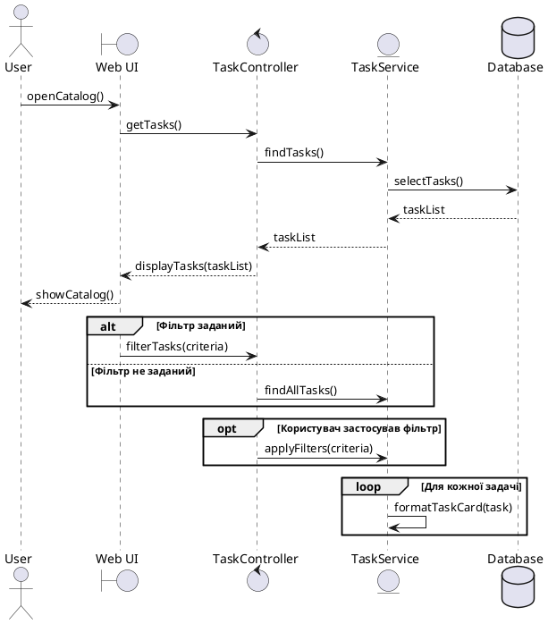

# 1 Промпт
    - Запит: Дай мені синтаксис для sequene діаграм PUML

    - Відповідь: (Sequence diagrams


## Основний синтаксис PlantUML



## Позначення

- `actor` — зовнішній актор.
- `boundary` — інтерфейс або UI.
- `control` — контролер, який координує операцію.
- `entity` — бізнес-сервіс або доменний об'єкт.
- `database` — база даних.
- `A -> B: action()` — синхронний виклик.
- `A --> B: result` — відповідь або повернення результату.
- `alt` — взаємовиключні варіанти, наприклад успіх або помилка.
- `opt` — необов'язкова поведінка.
- `loop` — повторення для набору елементів або поки виконується умова.
- `activate A` / `deactivate A` — показати період виконання учасника.
- `== Section ==` — розділ діаграми.

Назви повідомлень бажано писати як реальні операції системи:
`validateCredentials()`, `findAcceptedSubmissions()`,
`checkPremiumAccess()`, `saveSubmission()`, `showError()`.)


# 2 Промпт

    - Запит: дивись я зробив sequence діаграму для SC07 перевір її і скажи що не так

    - Відповідь: Перевірю `SC-07.puml` построчно та зіставлю його з кроками `SC-07` у специфікації.

Read 
Completed with input: {
  "path": "C:\\Users\\geoge\\OneDrive\\Рабочий стол\\KPI 2 LABS\\lab3\\sequence\\SC-07.puml"
}

"Read" failed
Completed with input: {
  "path": "C:\\Users\\geoge\\OneDrive\\Рабочий стол\\KPI 2 LABS\\lab3\\spec.md",
  "view_range": [
    80,
    130
  ]
}
Tool execution failed: view_range out of bounds

У твоїй `SC-07.puml` є правильна загальна ідея, але зараз діаграма має кілька суттєвих проблем.

## 1. Діаграма не закриває `alt`

У кінці є:

```plantuml
else Рішення не правильне
    ...
    UI --> User: showResults(status: Accepted)


@enduml
```

Потрібно додати:

```plantuml
end
@enduml
```

Інакше фрагмент `alt` не завершений, тому PlantUML може показати помилку синтаксису.

## 2. Помилка в назві учасника

У тебе:

```plantuml
entity "RunTime and Memory" as RunTime and Memory
```

Аліас не може містити пробіли. PlantUML сприйме `and Memory` некоректно.

Виправ, наприклад, так:

```plantuml
participant "ResourceMonitor" as ResourceMonitor
```

або:

```plantuml
entity "Runtime and Memory" as Metrics
```

Після цього використовуй:

```plantuml
System -> Metrics: calculate()
Metrics --> System: runtime, memory
```

Краще назвати цей компонент `ResourceMonitor`, тому що `runtime` і `memory` — це не окремий об'єкт предметної області, а вимірювані результати виконання.

## 3. `System` як `actor` — не дуже коректно

У тебе:

```plantuml
actor "System" as System
```

`actor` призначений для зовнішніх учасників: користувача, адміністратора або зовнішнього платіжного сервісу.

Системні компоненти краще описати як:

```plantuml
participant "Judge" as Judge
participant "CodeRunner" as Runner
database "Database" as DB
```

Наприклад:

```plantuml
Controller -> SubmissionService: createPendingSubmission()
SubmissionService -> DB: saveSubmission(status="Pending")
SubmissionService -> Judge: validateSubmission(submissionId)
```

## 4. Немає бази даних

У `SC-07` за специфікацією:

- створюється `Submission`;
- після успішної перевірки він отримує `Accepted`;
- фіксуються `runtime` та `memory`;
- правильне рішення зберігається в історії користувача.

У твоїй діаграмі немає операцій збереження в базу. Потрібно показати хоча б:

```plantuml
SubmissionService -> DB: saveSubmission(status="Pending")
DB --> SubmissionService: submissionId

...

SubmissionService -> DB: updateSubmissionStatus("Accepted")
SubmissionService -> DB: saveExecutionMetrics(runtime, memory)
SubmissionService -> DB: addToUserHistory()
```

Без цього не видно, як рішення зберігається в історії.

## 5. `Submission` не повинен сам перевіряти код

У тебе:

```plantuml
Submission -> TestCases: testSubmission()
```

`Submission` — це запис про відправлене рішення, а не компонент, який запускає код. Реалістичніше додати `Judge` і `CodeRunner`:

```plantuml
Judge -> Runner: executeSubmission(code, testCase)
Runner --> Judge: testPassed(runtime, memory)
```

Також `TestCases` краще назвати `TestCaseRepository` або просто `TestCaseProvider`, бо тест-кейси зазвичай надаються системі, а не виконують submission.

## 6. Помилка в альтернативній гілці

У тебе:

```plantuml
TestCases --> System: submission(status: Declined)
System --> UI: displayResults(status: Declined)
UI --> User: showResults(status: Accepted)
```

Останній рядок суперечить попереднім:

```plantuml
UI --> User: showResults(status: Accepted)
```

Якщо рішення відхилено, має бути:

```plantuml
UI --> User: showResults(status="Declined")
```

Але є ще важливіше питання: `SC-07` — це сценарій успішного рішення. Гілка `Declined` фактично належить до іншого альтернативного сценарію, наприклад невдалого тесту або `SC-08`.

Можна залишити `alt`, адже вимога просить фрагмент `alt/opt/loop`, але для `SC-07` краще показати:

```plantuml
alt Усі тест-кейси пройдено
    ...
else Тест не пройдено
    ...
end
```

А основна гілка повинна завершуватися `Accepted`.

## 7. Варто виправити назви операцій

Зараз є:

```plantuml
User -> UI: Submit()
```

Краще:

```plantuml
User -> UI: submitSolution(code, language, taskId)
```

Також:

```plantuml
User -> UI: selectLanguage()
```

краще деталізувати:

```plantuml
User -> UI: selectLanguage(language)
```

Назви мають бути в одному стилі: `camelCase`, з маленької літери.

## 8. Є друкарська помилка

У тебе двічі написано:

```plantuml
кжоному тест кейсі
```

Потрібно:

```plantuml
для кожного тест-кейсу
```

## Як може виглядати виправлена версія

Ось варіант, максимально близький до твоєї ідеї:

```plantuml
@startuml
title SC-07. Правильне рішення отримує статус Accepted

actor "User" as User
boundary "Web UI" as UI
control "SubmissionController" as Controller
entity "SubmissionService" as SubmissionService
participant "Judge" as Judge
participant "CodeRunner" as Runner
database "Database" as DB

User -> UI: selectLanguage(language)
User -> UI: submitSolution(code, language, taskId)

UI -> Controller: postSubmission(code, language, taskId, userId)
Controller -> SubmissionService: createPendingSubmission()
SubmissionService -> DB: saveSubmission(status="Pending")
DB --> SubmissionService: submissionId

SubmissionService -> Judge: validateSubmission(submissionId)

loop Для кожного тест-кейсу
    Judge -> Runner: executeTestCase(code, testCase)
    Runner --> Judge: testResult(runtime, memory)
end

alt Усі тест-кейси пройдено
    Judge -> SubmissionService: markAsAccepted(submissionId)
    SubmissionService -> DB: updateStatus("Accepted")
    SubmissionService -> DB: saveMetrics(runtime, memory)
    SubmissionService -> DB: addToUserHistory()
    SubmissionService --> Controller: acceptedSubmission
    Controller --> UI: displayResult("Accepted", runtime, memory)
    UI --> User: showAcceptedResult()
else Тест не пройдено
    Judge -> SubmissionService: markAsRejected(submissionId)
    SubmissionService -> DB: updateStatus("Rejected")
    SubmissionService --> Controller: rejectedSubmission
    Controller --> UI: displayResult("Rejected")
    UI --> User: showRejectedResult()
end

@enduml
```

### Підсумок

Найкритичніші проблеми:

1. немає `end` для `alt`;
2. некоректний аліас `RunTime and Memory`;
3. неправильна роль `System` як `actor`;
4. немає бази даних і збереження в історії;
5. `Submission` сам виконує тестування;
6. у помилковій гілці показується `Accepted`;
7. є друкарська помилка `кжоному`.

Після цих виправлень діаграма буде відповідати `SC-07` значно краще.