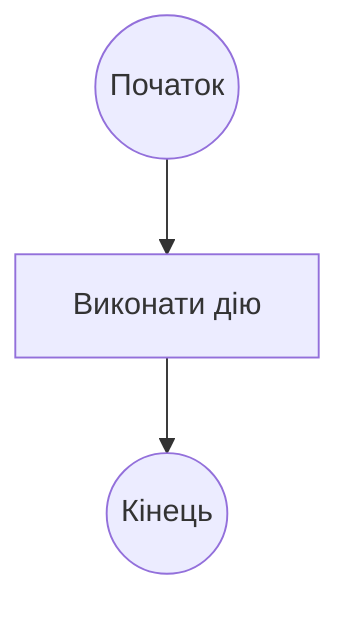
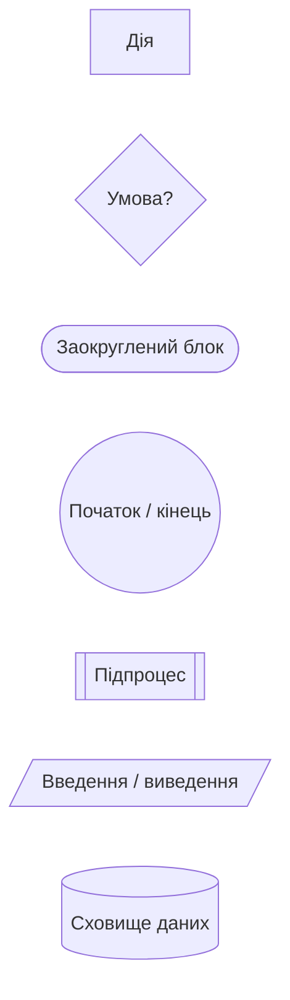
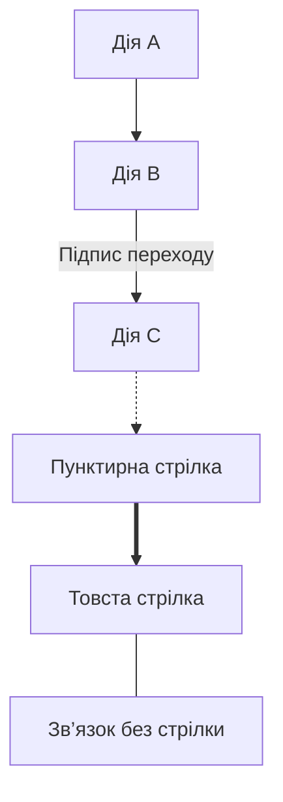
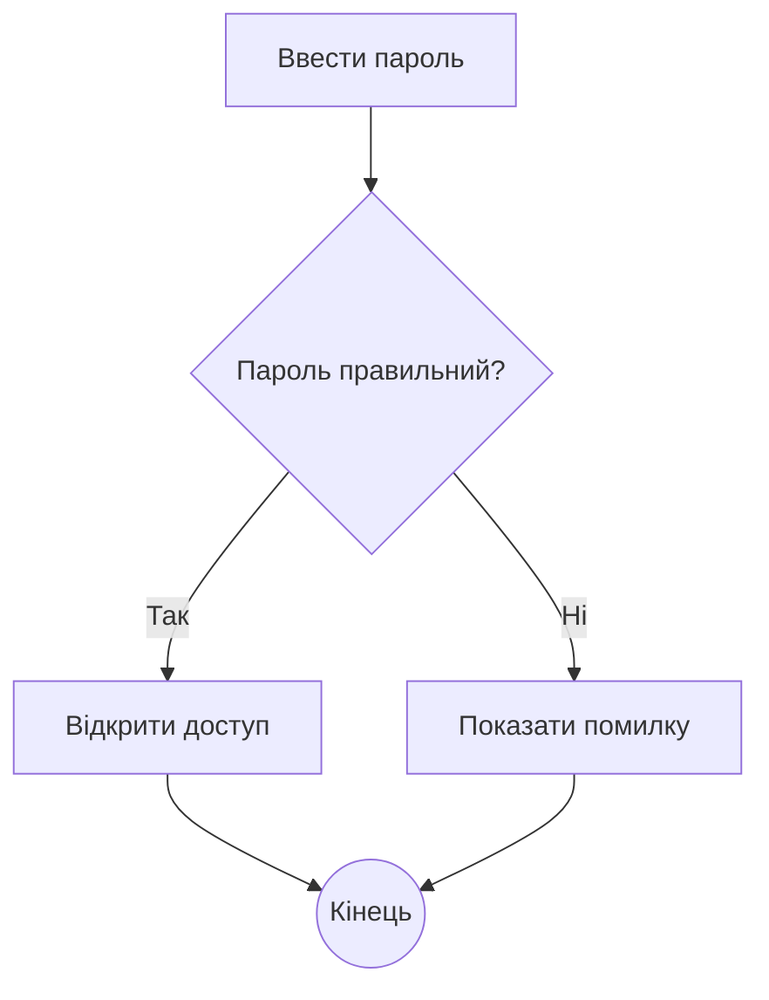
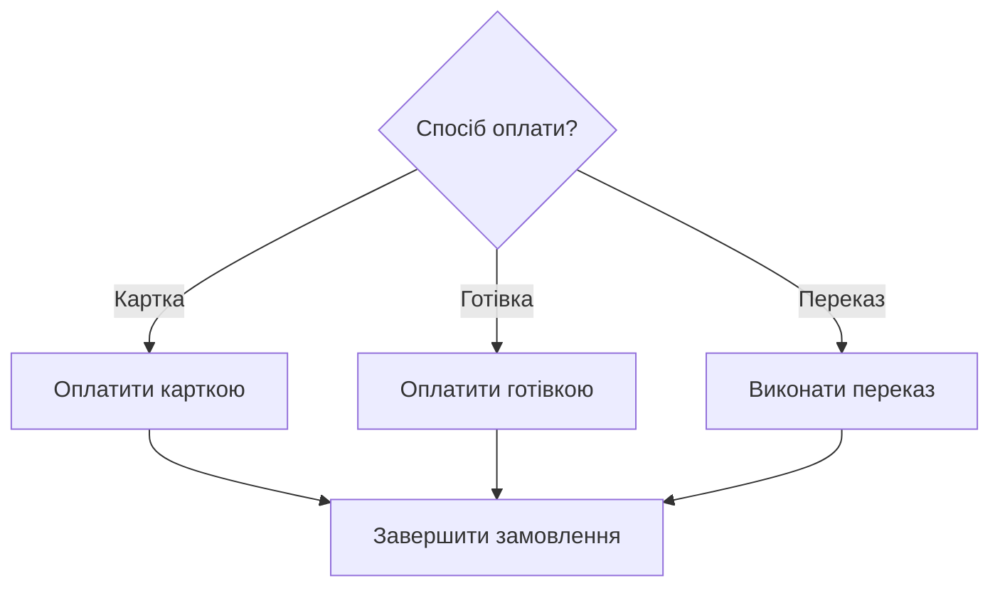
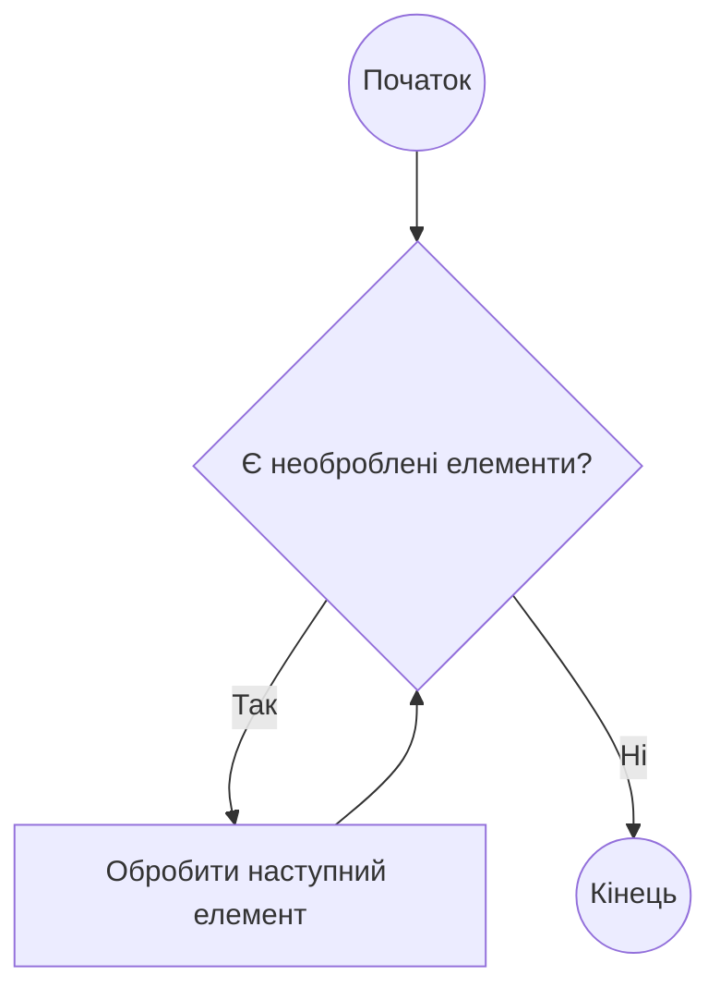
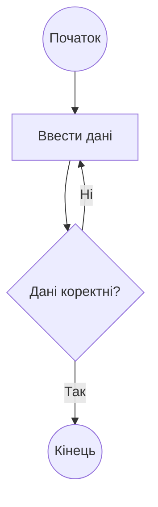
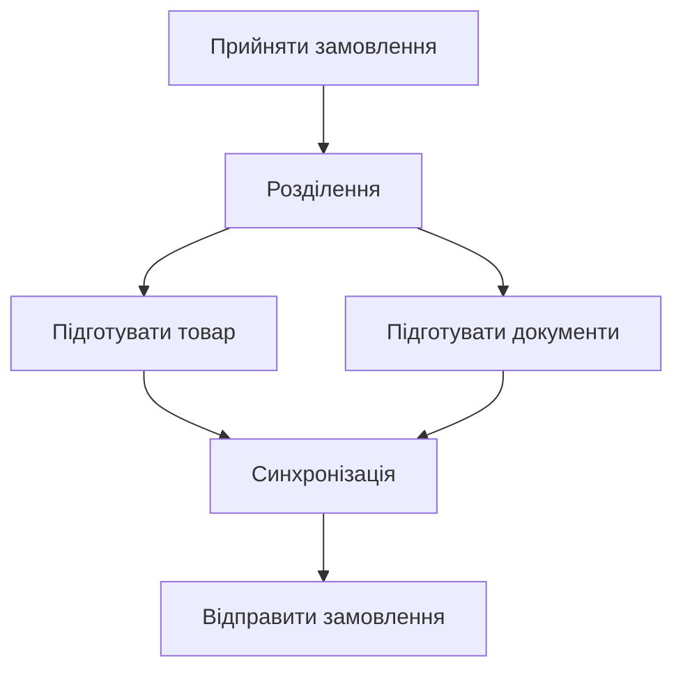
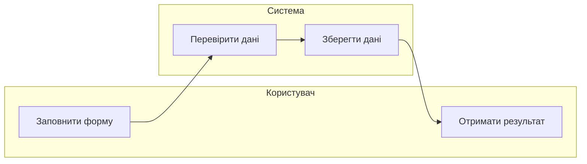
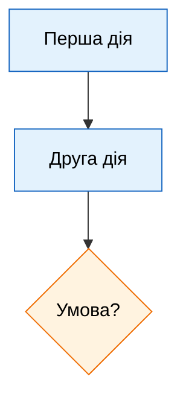

# 1 Промпт

- Запит: дивись я хочу зробити activity діаграму в mermaid flowchart дай мені весь основний синтаксис

- Відповідь:У Mermaid **activity-діаграму зазвичай будують через `flowchart`**: дії показують блоками, умови — ромбами, переходи — стрілками.

У файлі `.md` код потрібно обгорнути так:

````markdown

````

**1. Напрямок діаграми**

```text
flowchart TD    зверху вниз
flowchart TB    зверху вниз
flowchart BT    знизу вгору
flowchart LR    зліва направо
flowchart RL    справа наліво
```

**2. Основні форми вузлів**



`A`, `B`, `C` — унікальні ідентифікатори вузлів. Текст у лапках — підпис, який бачить читач.

**3. Стрілки й підписи**



Послідовність можна записувати одним рядком:

```text
A --> B --> C --> D
```

**4. Умова: `if / else`**



Обидві гілки можуть вести до одного вузла — це злиття альтернативних шляхів.

**5. Вибір із кількох варіантів**



**6. Цикл із перевіркою перед дією — `while`**



**7. Цикл із перевіркою після дії — `do while`**



**8. Паралельні дії**

У `flowchart` паралельність можна позначити умовними вузлами розділення та синхронізації:



Це **візуальна домовленість**: Mermaid `flowchart` сам не задає UML-семантику очікування завершення всіх гілок.

**9. Групування за учасниками — `subgraph`**

Так можна приблизно зобразити доріжки відповідальності:



**10. Коментарі, перенесення рядків і стилі**

Коментар починається з `%%`:

```text
%% Цей текст не відображається на діаграмі
```

Для перенесення рядка в підписі часто використовують `<br/>`:

```text
A["Перевірити дані<br/>користувача"]
```

Стиль окремого вузла:

```text
style A fill:#e8f5e9,stroke:#2e7d32,color:#000
```

Спільний стиль для кількох вузлів:



Для лабораторної найчастіше достатньо: **`flowchart TD`, `["Дія"]`, `{"Умова?"}`, `(("Початок"))`, `-->`, `-->|"Так"|` і `subgraph`**.

