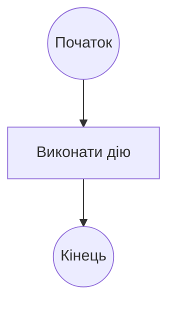
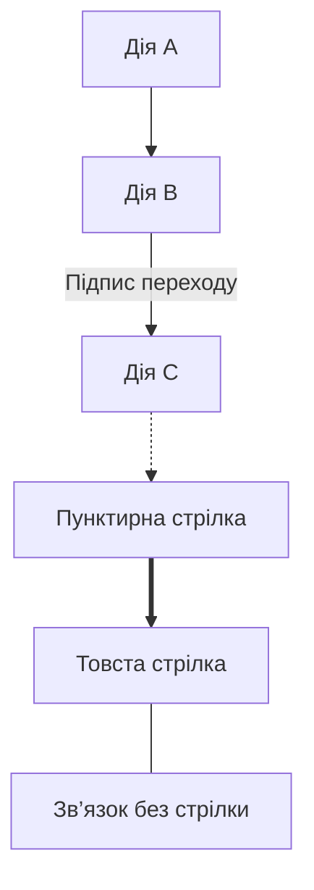
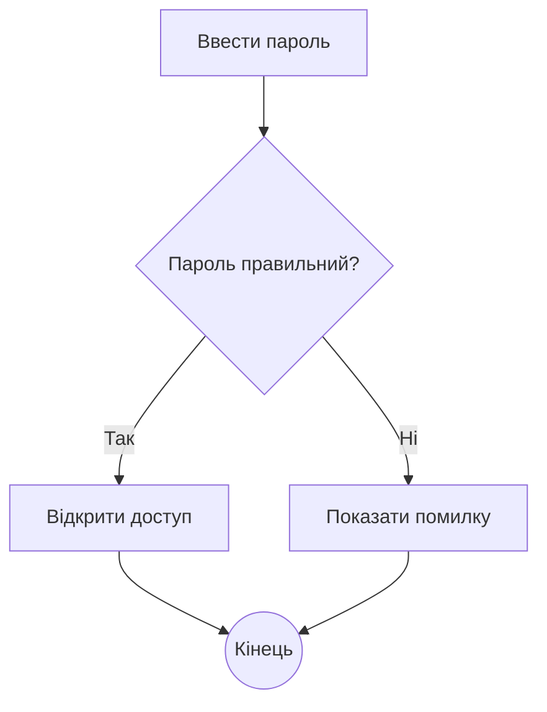
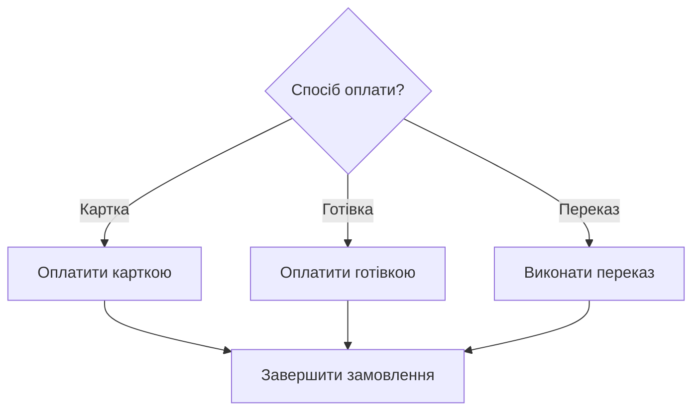
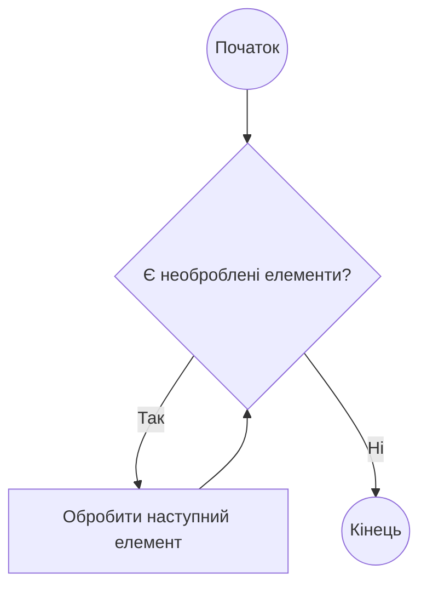
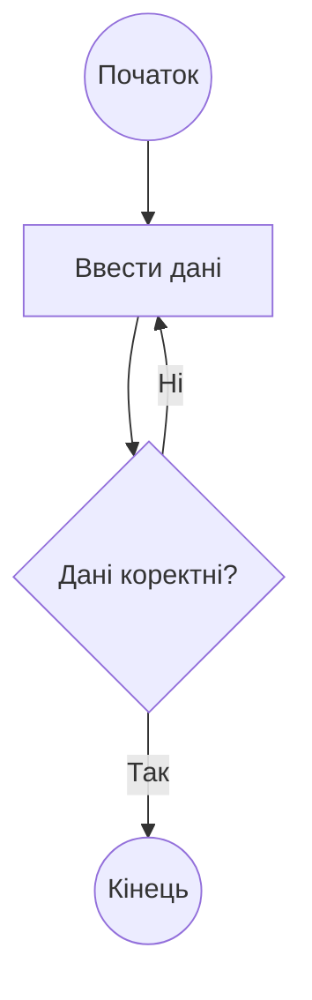
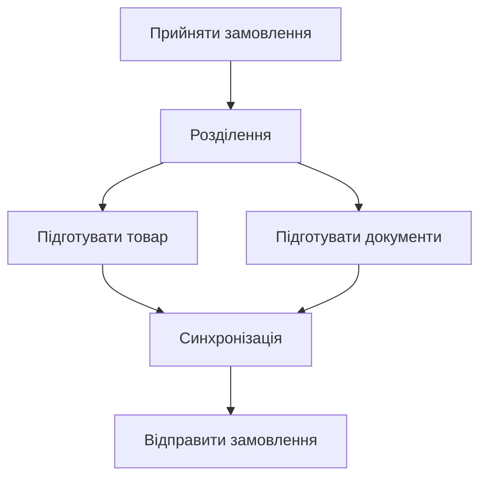
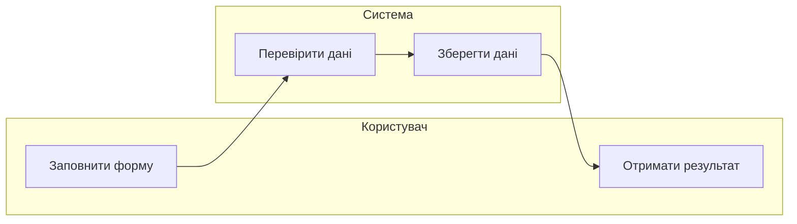
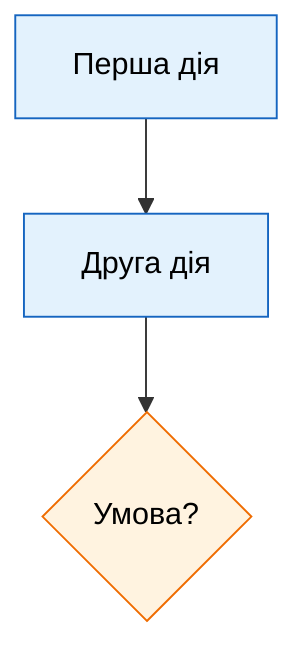

# 1 Промпт

- Запит: дивись я хочу зробити activity діаграму в mermaid flowchart дай мені весь основний синтаксис

- Відповідь:У Mermaid **activity-діаграму зазвичай будують через `flowchart`**: дії показують блоками, умови — ромбами, переходи — стрілками.

У файлі `.md` код потрібно обгорнути так:

````markdown

````

**1. Напрямок діаграми**

```text
flowchart TD    зверху вниз
flowchart TB    зверху вниз
flowchart BT    знизу вгору
flowchart LR    зліва направо
flowchart RL    справа наліво
```

**2. Основні форми вузлів**


`A`, `B`, `C` — унікальні ідентифікатори вузлів. Текст у лапках — підпис, який бачить читач.

**3. Стрілки й підписи**



Послідовність можна записувати одним рядком:

```text
A --> B --> C --> D
```

**4. Умова: `if / else`**



Обидві гілки можуть вести до одного вузла — це злиття альтернативних шляхів.

**5. Вибір із кількох варіантів**



**6. Цикл із перевіркою перед дією — `while`**



**7. Цикл із перевіркою після дії — `do while`**



**8. Паралельні дії**

У `flowchart` паралельність можна позначити умовними вузлами розділення та синхронізації:



Це **візуальна домовленість**: Mermaid `flowchart` сам не задає UML-семантику очікування завершення всіх гілок.

**9. Групування за учасниками — `subgraph`**

Так можна приблизно зобразити доріжки відповідальності:



**10. Коментарі, перенесення рядків і стилі**

Коментар починається з `%%`:

```text
%% Цей текст не відображається на діаграмі
```

Для перенесення рядка в підписі часто використовують `<br/>`:

```text
A["Перевірити дані<br/>користувача"]
```

Стиль окремого вузла:

```text
style A fill:#e8f5e9,stroke:#2e7d32,color:#000
```

Спільний стиль для кількох вузлів:



Для лабораторної найчастіше достатньо: **`flowchart TD`, `["Дія"]`, `{"Умова?"}`, `(("Початок"))`, `-->`, `-->|"Так"|` і `subgraph`**.

# 2 Промпт

- Запит: дивись я зараз роблю 4 лабораторку на основі 2-ої та 3-ої, ось завдання - Мета: описати один бізнес-процес однією точною формою (без «двох нотацій»).

Артефакт (текст + рендер): Activity-діаграма (Mermaid flowchart / PlantUML activity), BPMN-діаграма (BPMN 2.0 XML з bpmn.io / Camunda Modeler) АБО машина станів (Mermaid stateDiagram-v2) для одного процесу — початок/кінець, дії, потоки керування, розгалуження (if/else), паралельні гілки (fork/join), ролі (swimlanes / пули в BPMN) за потреби. Рендер — діаграма з цього опису.

Повідомлення — обов'язково: щонайменше одне надсилання повідомлення іншому учаснику (користувач, зовнішня система, інша роль) і показано, що відбувається далі (відповідь/подія або продовження без очікування). У BPMN — message flow між пулами і message events; в activity — send signal / accept event; у машині станів — перехід з подією-повідомленням. Діаграма без повідомлень не вважається виконаною.

Що зробити:
• spec.md: процес, що деталізує UC із Завдання 2; кроки, ролі, розгалуження, повідомлення; яку форму обрано (activity / BPMN / машина станів) і чому.
• Побудувати одну декларативну форму (activity, BPMN АБО машину станів); згенерувати рендер.
• Аудит: повнота переходів, досяжність станів, коректність умов, паралельні гілки/join; для кожного повідомлення — хто надсилає, хто приймає, що робить процес без відповіді; звірити з UC (Завдання 2) і Sequence (Завдання 3) — повідомлення процесу відповідають повідомленням sequence-діаграми; топ-3 розбіжності.
• DEFENSE.md: чому така структура станів/кроків, як вирішено спірні місця.

Ознаки відмінного виконання: логіка повна (без недосяжних станів і «дір» у переходах); є ≥1 розгалуження й ≥1 паралельна гілка; є ≥1 надсилання повідомлення з показаною реакцією на відповідь або її відсутність; вибір форми обґрунтовано; узгодженість з UC/Sequence.

Якщо з AI: AI не є джерелом вимог і рішень — йому ставиться задача аналізу й дозбору (знайти прогалини, поставити уточнювальні питання, запропонувати варіанти), а формулює й вирішує студент; spec.md і DEFENSE.md — власноруч (DoD §1).

Здача — 2 входи:
• Посилання на GitHub PR.
• DEFENSE — заповніть прикріплений шаблон (Google Doc, копія для кожного студента) або додайте власний DEFENSE.md.

Дедлайн: сб, 5 грудня 2026 · Оцінювання: вчасно — 16 балів, поза строком — 10.

Повні вимоги до здачі — у матеріалі «Definition of Done — повні версії».  

я зробив діаграму в activity.md перевір її і скажи що норм а що можна ще доробити

- Відповідь: Переглянув `lab4/activity.md`, специфікацію, вимоги другої лабораторної та обидві sequence-діаграми третьої. **Основа є, але зараз це ще чернетка: бракує завершення процесу, паралельності та повного обміну повідомленнями. Найсуттєвіша помилка — запуск коду стоїть після перевірки результатів тестів.** Файли не змінював.

**Що вже нормально**

- Обрано одну форму — Mermaid `flowchart`, як дозволяє завдання.
- Є зрозумілий початок і послідовність дій користувача: вибір задачі → мови → написання коду → надсилання.
- Є розподіл відповідальності через `Client`, `System`, `Judge`. Це придатне наближення swimlanes.
- Є розгалуження з підписаними виходами `yes` / `no`.
- Є намір показати повідомлення: `send code` → `receive code`.

**Що потрібно доробити насамперед**

**1. Виправити порядок перевірки.**

Зараз у тебе:

```text
Отримати код → Чи пройдено всі тести? → Надіслати в CodeRunner
```

Але дізнатися результат можна лише після виконання коду. Відповідно до sequence має бути приблизно так:

```text
Judge отримує запит
→ завантажує тест-кейс
→ надсилає executeTestCase до CodeRunner
→ отримує testResult
→ перевіряє результат і ліміти
→ переходить до наступного тесту або формує фінальний вердикт
```

Доцільно додати доріжку `CodeRunner`, оскільки він уже є учасником третьої лабораторної.

**2. Показати зміни `Submission`, а не лише повідомлення користувачу.**

`Create submission` потрібно уточнити до **створення зі статусом `Pending`**. Після перевірки треба явно показати збереження фінального статусу.

Для успішного шляху у вимогах є:

```text
Усі тести пройдено
→ зберегти Accepted, runtime_ms, memory_kb
→ повідомити користувача
```

Для неуспішного недостатньо загального `information about fail`: потрібні відповідні результати — `Wrong Answer`, `Time Limit Exceeded`, `Runtime Error`, `Compilation Error`, якщо діаграма охоплює весь процес, заявлений у твоєму `spec.md`.

**3. Додати явний кінець для всіх шляхів.**

Зараз `G3` і `D1` просто обриваються. Це досяжні вузли, але завершення activity не позначене.

Після відображення успішного результату та помилки можна перейти до спільного `End`. Повернення до редагування коду теж можливе, але це вже твоє рішення про межі процесу.

**4. Додати справжній fork/join.**

Зараз паралельних гілок немає. Виходи `yes` і `no` з ромба — це альтернативи, вони не виконуються одночасно.

Один **варіант для твого розгляду**, який спирається на REQ-15: після `Accepted` паралельно оцінювати часову й просторову складність, а після join зберігати обидві оцінки та показувати результат.

У Mermaid потрібно явно підписати вузли `fork` і `join` та пояснити, що join очікує завершення обох гілок. Сам `flowchart` цю семантику не перевіряє. Також цей варіант потребуватиме відображення розбіжності з поточною sequence, де таких дій немає.

**5. Зробити повідомлення однозначними.**

Твоє `send code` → `receive code` — хороший початок, але `[[...]]` саме по собі не позначає send signal / accept event: у flowchart це форма підпроцесу.

Для цієї роботи варто явно написати, наприклад:

- `Send signal: executeTestCase(code, testCase)` у `Judge`;
- `Accept event: executeTestCase` у `CodeRunner`;
- зворотне повідомлення `testResult`;
- приймання результату й подальшу дію `Judge`.

Окремо потрібно визначити, **що відбувається без відповіді**. Очікування, повторний запит або технічна помилка — це рішення студента, якого поточні вимоги однозначно не встановлюють. Не варто автоматично прирівнювати відсутність відповіді сервісу до `Time Limit Exceeded`: останній у REQ-11 означає виконання коду понад 2000 мс.

**Топ-3 розбіжності для аудиту**

| Розбіжність | Що саме виявлено |
|---|---|
| Порядок виконання | В activity перевірка проходження тестів передує запуску `CodeRunner`; у sequence запуск і отримання результату відбуваються раніше |
| Неповний результат процесу | Activity не показує `Pending`, збереження фінального статусу та метрик, які є в UC/Sequence |
| Неузгоджені сценарії та статуси | У lab2 `SC-08` — це `Wrong Answer`, а перевищення часу — `SC-09`; у lab3 файл `SC-08.puml` описує перевищення часу. До того ж sequence використовує `Rejected`, якого немає в допустимих статусах lab2 |

Це означає, що **третю лабораторну теж не слід брати за безпомилковий еталон**: розбіжності потрібно зафіксувати й узгодити.

Із дрібнішого: виправ `sumbission`, `recieve`, `succsefully`; вузол успішного повідомлення `D1` краще назвати змістовніше та відокремити надсилання результату системою від його отримання користувачем.

Ще у `lab4/spec.md` є фраза «для нефінального результату `Accepted`» — за контекстом мало бути «для фінального результату, відмінного від `Accepted`». І «може обчислити оцінки складності» слабше за REQ-15, де обчислення обов’язкове.

**Перший пріоритет: виправити порядок Judge → CodeRunner → результат, додати статуси й кінцевий вузол. Далі — явні повідомлення з поведінкою без відповіді та обґрунтований fork/join.** Наявність Mermaid-блоку перевірив; фактичний рендер у цій перевірці не запускав.